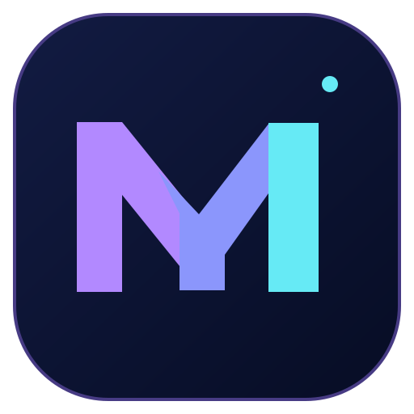

<div align="center">



# ✦ MAH DailyDesk

**Your everyday productivity command center — beautifully simple, fully offline.**


[](https://github.com/mahmiasghar63/mah-dailydesk/actions/workflows/tests.yml)
[](https://github.com/mahmiasghar63/mah-dailydesk/actions/workflows/security.yml)
[](LICENSE)
[](https://github.com/mahmiasghar63/mah-dailydesk/releases/tag/v1.0.0)

[**Download for Windows**](https://github.com/mahmiasghar63/mah-dailydesk/releases/tag/v1.0.0) · [**Report an issue**](https://github.com/mahmiasghar63/mah-dailydesk/issues) · [**Contribute**](CONTRIBUTING.md)

*Plan the day. Capture ideas. Track habits. Build focus.*

</div>

## Overview

MAH DailyDesk is an open-source desktop productivity app, built with **Python**, **PySide6 (Qt)** and **SQLite**. It's designed for students, creators, developers and anyone who wants a practical daily workspace. Your content is saved locally on your machine; no account is required.

> **Release status:** The Windows v1.0.0 portable ZIP is published and **unsigned**. Future versioned releases are now gated on a verified code-signing provider and Authenticode signature verification. See [CODE_SIGNING.md](CODE_SIGNING.md) for provider setup. No installer is supplied.

## Features

| Section | What it does |
| --- | --- |
| **Dashboard** | Live summary of active tasks, completed tasks, daily habits, focus minutes and upcoming activities |
| **Tasks** | Add, edit, search, prioritize, filter, progress and delete tasks, with optional due dates |
| **Notes** | Searchable local notes, tags, editable content and automatic saving when changing notes or closing |
| **Planner** | Calendar, scheduled activities, durations, notes and completed-state tracking |
| **Habits** | Daily check-ins, streak calculation and last-seven-days progress indicators |
| **Expenses** | Local spending ledger, categories, monthly navigation and category bar chart |
| **Focus** | Start, pause and reset focus sessions with 15/25/50-minute presets and completed-session logging |
| **Settings** | Live dark/light themes, four accent colors, currency display, SQLite backups and CSV exports |

Other interface features: an interactive **Ctrl+K command palette**, keyboard navigation, responsive Qt widgets, safe delete confirmations, and an offline-first storage model.

### Interface previews

These are genuine Qt screenshots captured with **disposable demo data** during the Windows v1.0.0 build. Select an image to view it at full size.

<p align="center">
  <a href="https://github.com/mahmiasghar63/mah-dailydesk/releases/download/v1.0.0/dashboard.png"></a>
  <a href="https://github.com/mahmiasghar63/mah-dailydesk/releases/download/v1.0.0/tasks.png"></a>
  <a href="https://github.com/mahmiasghar63/mah-dailydesk/releases/download/v1.0.0/settings.png"></a>
</p>

The same screenshots, the application ZIP and its checksum are available on the [v1.0.0 release page](https://github.com/mahmiasghar63/mah-dailydesk/releases/tag/v1.0.0).

## Download — Windows 10 or 11 (64-bit)

**No Python installation is needed to run the downloadable Windows app.**

For a Windows build that does not require Python, visit [GitHub Releases](https://github.com/mahmiasghar63/mah-dailydesk/releases/latest) and download `MAH-DailyDesk-v1.0.0-Windows-x64.zip`. Extract the entire folder, then run `MAH-DailyDesk.exe` inside. Keep all adjacent bundled files together. This is an **unsigned** binary, so only download from the official repository and verify its SHA-256 checksum if desired. Your data remains in `%LOCALAPPDATA%\MAH-DailyDesk\` between app upgrades.

### Frequently asked questions

**Does the Windows download require Python?** No. Extract the complete ZIP and run the executable inside its folder.

**Does it sync my data online?** No. DailyDesk stores its data locally and has no account or cloud sync.

**Will updating delete my tasks?** The app keeps its data in your user profile, not the installation folder. Still make a backup before any upgrade.

**Does it include an installer or a signed publisher certificate?** No. The published v1.0.0 release is a portable, unsigned ZIP; signing for later releases needs an approved external provider.

## Quick start from source — Windows 10 or 11

**Requirements:** Python 3.11 or newer, internet access for the initial package installation, and Windows 10/11. PySide6 wheel availability depends on the Python version and system architecture.

1. Download the source ZIP or clone the repository:

   ```bat
   git clone https://github.com/mahmiasghar63/mah-dailydesk.git
   cd mah-dailydesk
   ```

2. Run `run_windows.bat`, which creates `.venv`, installs PySide6 and opens the application.

If you'd rather install manually, open CMD in the source folder:

```bat
python -m venv .venv
.venv\Scripts\python -m pip install -r requirements.txt
.venv\Scripts\python main.py
```

If a particular Python version cannot install PySide6, install a supported 64-bit Python (3.12 or 3.13 is a good alternative) and recreate `.venv`.

### Linux or macOS

```bash
python3 -m venv .venv
source .venv/bin/activate
python -m pip install -r requirements.txt
python main.py
```

Platform availability depends on Qt and operating-system support. Windows is the primary target.

## Keyboard shortcuts

| Shortcut | Result |
| --- | --- |
| `Ctrl+1` ... `Ctrl+8` | Navigate between the eight main sections |
| `Ctrl+K` | Open the quick-launch/search palette |
| `Ctrl+N` | Add a new task |
| `Enter` in command palette | Open selected item |
| `Esc` in command palette | Close the palette |

## Storage and privacy

The database is created automatically in your **user data folder**, not inside the Git repository:

- **Windows:** `%LOCALAPPDATA%\MAH-DailyDesk\dailydesk.sqlite3`
- **Linux:** `~/.local/share/MAH-DailyDesk/dailydesk.sqlite3` (or `$XDG_DATA_HOME`)

MAH DailyDesk doesn't upload notes, tasks or expenses to a server. SQLite keeps your data in a local database. You can create a backup through **Settings → Backup database**, and export data into CSV through **Settings → Export CSV files**. Keep backups private if they contain personal information. CSV exports may include untrusted text; open them carefully in spreadsheet applications.

## Project structure

```text
mah-dailydesk/
├── main.py                 # Local application entry point
├── pyproject.toml          # Package metadata / installable entry point
├── dailydesk/
│   ├── app.py              # Shared GUI launcher
│   ├── __main__.py         # python -m dailydesk
│   ├── core/
│   │   └── storage.py       # Offline database and data operations
│   └── ui/
│       ├── command_palette.py
│       ├── main_window.py
│       ├── pages.py
│       ├── theme.py
│       └── widgets.py
├── tests/
│   ├── test_storage.py
│   └── test_gui.py
├── screenshots/
├── .github/workflows/tests.yml
├── .github/workflows/release.yml
├── tools/                   # Icon generation, screenshots and frozen-app smoke checks
├── assets/                  # Brand artwork
├── release/                 # Version and GitHub Release notes
├── run_windows.bat
├── build_windows.bat
├── requirements.txt
├── requirements-dev.txt
├── PUBLISHING.md
├── .gitignore
├── LICENSE
└── README.md
```

## Running tests

Test database features without needing PySide6:

```bash
python -m pip install pytest
python -m pytest -q tests/test_storage.py
```

Test the UI (requires PySide6 and a graphical environment):

```bash
python -m pip install -r requirements.txt pytest
python -m pytest -q tests/test_gui.py
```

The GitHub Actions workflow runs both the core tests and a headless Qt GUI smoke check.

## Building a Windows executable

After the app runs correctly on Windows, launch **`build_windows.bat`**. It installs PyInstaller and creates an *onedir* bundle in `dist\MAH-DailyDesk\`. Distribute the complete folder, not only the `.exe`.

A GitHub Actions workflow on a hosted Windows runner builds the packaged application, runs tests, generates GUI previews, and for future versions **requires a verified signing provider** before it will publish the ZIP, preview images and SHA-256 checksum. New release ZIPs also receive GitHub provenance attestations. See [PUBLISHING.md](PUBLISHING.md) and [CODE_SIGNING.md](CODE_SIGNING.md).

## Release integrity and security

The published **v1.0.0** Windows ZIP is **unsigned**. New releases are configured to require verified signing and checks, but no external signing provider has been connected yet. Download it only from the [official GitHub release](https://github.com/mahmiasghar63/mah-dailydesk/releases/latest), and compare its SHA-256 hash against the published `SHA256SUMS.txt` using `Get-FileHash -Algorithm SHA256 <downloaded-zip>` in PowerShell. Hash verification checks integrity against the published checksum; it is not a malware certification. Automated dependency checks, source scanning and Dependabot help identify issues but do not guarantee the absence of vulnerabilities. See [SECURITY.md](SECURITY.md) and [PUBLISHING.md](PUBLISHING.md).

## Roadmap

- [x] Offline storage and essential productivity modules
- [x] Dark and light interface, accents, searchable notes
- [x] Global quick-launch palette and calendar-based planning
- [x] Automated core unit tests
- [x] Windows source launch verified by owner; automated demo screenshots included in the release pipeline
- [ ] Accessibility and screen-reader review
- [ ] Optional secure data import / restore workflow
- [x] Automated unsigned Windows ZIP release pipeline
- [x] Verified-signature requirement and signed-release pipeline integration (provider setup pending)
- [ ] Connect an approved code-signing provider and publish a signed Windows release
- [ ] Signed installer (optional)

## Contributing and support

Bug reports, improvement ideas and pull requests are welcome. Start with [CONTRIBUTING.md](CONTRIBUTING.md) for setup, testing, code style and review guidance. Use [GitHub Issues](https://github.com/mahmiasghar63/mah-dailydesk/issues) for reproducible bugs or feature proposals, but **never post personal databases, private data or vulnerability details in public issues**; see [SECURITY.md](SECURITY.md) for security reporting.

If you are interested in how versions are packaged, see [PUBLISHING.md](PUBLISHING.md). Genuine code signing for later versions requires an approved provider; the configuration and limitations are documented in [CODE_SIGNING.md](CODE_SIGNING.md).

## License

Licensed under the [MIT License](LICENSE). Copyright © 2026 MAH.

---

<div align="center">Made with Python · Built to make everyday work easier.</div>